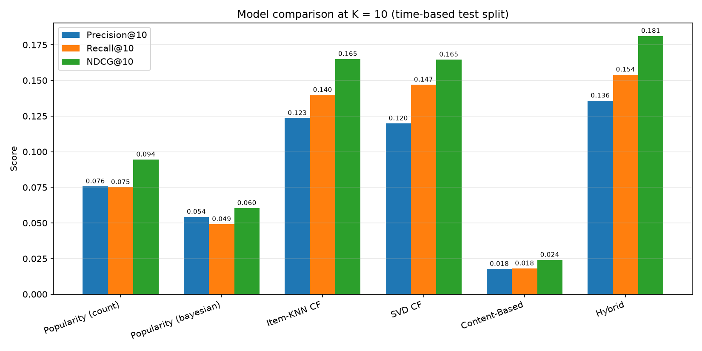
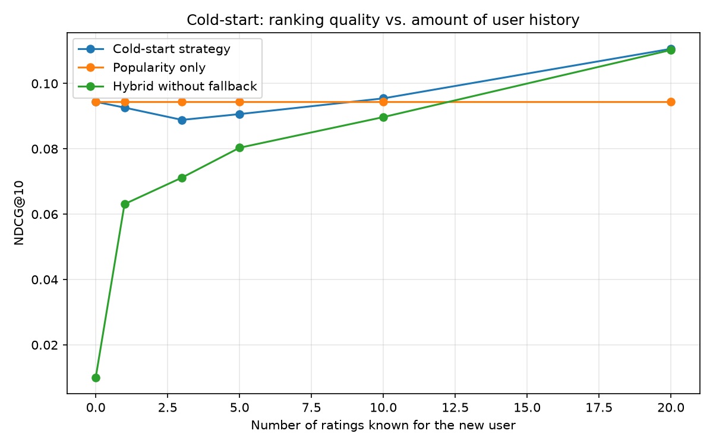

# Movie Recommendation System

A recommender system built on the **MovieLens 100K** dataset. It implements a popularity baseline, collaborative filtering (item-based KNN and SVD), a content-based model and a tuned hybrid model. All models are evaluated with ranking metrics (**Precision@K, Recall@K, NDCG@K**) on a proper **per-user time-based train/test split**, and the project includes a dedicated strategy (and evaluation) for **new users with no history**.


---

## Table of Contents

1. [Project Overview](#1-project-overview)
2. [Key Results](#2-key-results)
3. [Dataset](#3-dataset)
4. [Project Structure](#4-project-structure)
5. [Installation](#5-installation)
6. [How to Run](#6-how-to-run)
7. [Methodology](#7-methodology)
8. [Evaluation Metrics](#8-evaluation-metrics)
9. [Detailed Results](#9-detailed-results)
10. [Handling New Users (Cold Start)](#10-handling-new-users-cold-start)
11. [Using the Cold-Start Recommender in Code](#11-using-the-cold-start-recommender-in-code)
12. [Configuration](#12-configuration)
13. [Limitations and Future Work](#13-limitations-and-future-work)
14. [Reproducibility](#14-reproducibility)
15. [References and Author](#15-references-and-author)

---

## 1. Project Overview

The goal is to recommend movies a user is likely to enjoy and to measure, honestly and reproducibly, how well each approach ranks the movies the user will actually like in the future.

| Requirement | Implementation |
|---|---|
| Popularity baseline | `Popularity (count)` and `Popularity (bayesian)` |
| Collaborative filtering | `Item-KNN CF` (cosine similarity) and `SVD CF` (matrix factorization) |
| Content-based / hybrid | `Content-Based` (genres + decade, TF-IDF) and a weighted `Hybrid` |
| Ranking metrics | Precision@K, Recall@K, NDCG@K (plus HitRate@K and Coverage@K) |
| Proper train/test split | Per-user chronological split (oldest 80% train, newest 20% test) |
| New users with no history | Popularity, genre onboarding and a gradual hand-over to personalization |

---

## 2. Key Results

Test-set results at **K = 10** (908 users with at least one relevant test item):

| Model | Precision@10 | Recall@10 | NDCG@10 |
|---|---|---|---|
| Popularity (count) | 0.0756 | 0.0750 | 0.0944 |
| Popularity (bayesian) | 0.0542 | 0.0490 | 0.0603 |
| Item-KNN CF | 0.1235 | 0.1397 | 0.1649 |
| SVD CF | 0.1197 | 0.1469 | 0.1645 |
| Content-Based | 0.0176 | 0.0180 | 0.0240 |
| **Hybrid (tuned)** | **0.1357** | **0.1540** | **0.1811** |

* The **hybrid model is the best on all three metrics**, improving NDCG@10 by about **92%** over the popularity baseline (0.1811 vs 0.0944).
* Without any special handling, personalized models fail for new users. The cold-start strategy fixes this (see [Section 10](#10-handling-new-users-cold-start)).



---

## 3. Dataset

**MovieLens 100K** (GroupLens Research): 100,000 ratings (1 to 5 stars) from 943 users on 1,682 movies. Every user has at least 20 ratings. The rating matrix is about 93.7% sparse.

| File | Content | Used for |
|---|---|---|
| `u.data` | `user_id, item_id, rating, timestamp` | All models |
| `u.item` | Title, release date, 19 genre flags | Content-based model, titles |

The dataset is **not included** in this repository. Download it once and extract it to `data/ml-100k/`:

```powershell
# Windows PowerShell
mkdir data -Force
Invoke-WebRequest -Uri "https://files.grouplens.org/datasets/movielens/ml-100k.zip" -OutFile "data\ml-100k.zip"
Expand-Archive -Path "data\ml-100k.zip" -DestinationPath "data" -Force
```

```bash
# Linux / macOS
mkdir -p data && cd data
curl -O https://files.grouplens.org/datasets/movielens/ml-100k.zip
unzip ml-100k.zip
```

---

## 4. Project Structure

```
Recommendation System/
├── data/
│   └── ml-100k/                  # MovieLens 100K (downloaded separately)
├── src/
│   ├── config.py                 # All paths and hyper-parameters
│   ├── data_loader.py            # Loading, time-based split, leakage check
│   ├── base.py                   # Common recommender interface
│   ├── popularity.py             # Popularity baselines
│   ├── collaborative.py          # Item-KNN and SVD collaborative filtering
│   ├── content_based.py          # Content-based model (genres + decade)
│   ├── hybrid.py                 # Weighted hybrid and weight tuning
│   ├── cold_start.py             # New-user strategy and its evaluation
│   ├── metrics.py                # Precision, Recall, NDCG, HitRate, Coverage
│   ├── evaluate.py               # Top-N generation and evaluation helpers
│   └── visualize.py              # Result plots
├── results/                      # Generated evaluation outputs
│   ├── metrics.csv
│   ├── cold_start_metrics.csv
│   ├── hybrid_weights.json
│   ├── hybrid_weight_search.csv
│   ├── model_comparison.png
│   ├── cold_start.png
│   └── sample_recommendations.txt
├── main.py                       # End-to-end pipeline
├── requirements.txt
└── README.md
```

---

## 5. Installation

**Requirements:** Python 3.10 or newer (developed and tested on Python 3.11 and 3.12).

```powershell
# 1. Create and activate a virtual environment
python -m venv venv
venv\Scripts\activate            # Linux/macOS: source venv/bin/activate

# 2. Install the dependencies
pip install -r requirements.txt
```

Dependencies: `numpy`, `pandas`, `scipy`, `scikit-learn`, `matplotlib`.

---

## 6. How to Run

Run everything from the project root folder:

```powershell
python main.py
```

The full run (including hybrid weight tuning) takes roughly one to two minutes on a normal laptop. Useful options:

| Command | Effect |
|---|---|
| `python main.py` | Full pipeline with hybrid weight tuning (use this for final results) |
| `python main.py --skip-tuning` | Skips the weight search and uses fixed default weights (quick test) |
| `python main.py --data-dir PATH` | Use a different dataset location |
| `python main.py --results-dir PATH` | Save the outputs to a different folder |

**Pipeline steps:** load data, time-based split and leakage check, train and evaluate every model, tune and evaluate the hybrid, run the cold-start experiment, write the result files and plots.

---

## 7. Methodology

### 7.1 Train/test split (no future leakage)

A random split would let the model learn from ratings that happened *after* the ratings it is tested on. Instead, a **per-user chronological split** is used:

* For every user, ratings are sorted by timestamp. The **oldest 80%** go to the train set and the **newest 20%** go to the test set.
* Users with fewer than 5 ratings stay entirely in the train set.
* `verify_no_leakage()` asserts that no user has a train rating newer than a test rating.
* Result: **79,619 train ratings** and **20,381 test ratings**.

**Relevant items.** A test item counts as relevant if the user rated it **4 or higher**. Users with no relevant test item cannot be scored and are skipped (908 of 943 users are evaluated). Movies the user already rated in the train set are **never recommended**.

**Hyper-parameter tuning** (hybrid weights) uses a *validation split*: the newest 20% of the **train** data. The test set is never used for any decision, so the reported test results are unbiased.

### 7.2 Models

All models share one interface: they learn from the train ratings and return a score for every movie, for any number of users. Because scoring works on arbitrary rating rows, the same model can also score brand-new users.

**Popularity baseline**
* `count`: movies ranked by number of ratings.
* `bayesian`: weighted rating that shrinks movies with few votes towards the global average, so a single 5-star vote cannot reach the top.
* The same list is shown to every user.

**Item-based KNN (collaborative filtering)**
* Cosine similarity between movie rating vectors.
* Similarities are shrunk by `co / (co + shrinkage)`, where `co` is the number of users who rated both movies, so pairs with little evidence count less.
* Only the 50 most similar movies are kept per movie.
* Score of a movie for a user: sum of the user's ratings of similar movies, weighted by similarity.

**SVD (collaborative filtering)**
* Truncated SVD (50 latent factors) of the user-item rating matrix (the "PureSVD" approach, which suits top-N ranking).
* A new user is *folded in* by projecting their rating vector onto the movie factors, so no retraining is required.

**Content-based**
* Movie vector: 19 genre flags + release decade, re-weighted with **TF-IDF** so rare genres count more than very common ones.
* User profile: rating-weighted sum of the vectors of the movies the user liked (rating of 4 or more); falls back to all rated movies if the user liked nothing.
* Score: cosine similarity between the user profile and each movie.
* Can also build a profile from a list of favourite genres alone (used for onboarding).

**Hybrid**
* Weighted sum of the popularity, Item-KNN, SVD and content scores.
* Scores live on different scales, so each model's scores are **min-max normalized per user** (over unseen movies only) before blending.
* Weights are chosen by an exhaustive grid search (step 0.1, 286 combinations that sum to 1) on the validation split, maximizing NDCG@10.
* Selected weights: `popularity 0.0`, `item_knn 0.6`, `svd 0.2`, `content 0.2` (validation NDCG@10 = 0.1728).

---

## 8. Evaluation Metrics

For every evaluated user, the top-K unseen movies are compared with the user's relevant test movies. Results are averaged over users.

| Metric | Meaning |
|---|---|
| **Precision@K** | Share of the K recommendations that are relevant |
| **Recall@K** | Share of the user's relevant movies found in the top K |
| **NDCG@K** | Like precision, but hits near the top of the list are worth more (position discount `1 / log2(rank + 1)`), normalized by the best possible ranking |
| **HitRate@K** | Share of users with at least one relevant movie in the top K |
| **Coverage@K** | Share of the catalogue that appears in anyone's top K (a diversity indicator) |

The metrics are implemented in `src/metrics.py` with vectorized NumPy and were checked against a hand-calculated example.

---

## 9. Detailed Results

Full test-set results at K = 10 (K = 5 and K = 20 are in `results/metrics.csv`):

| Model | Precision@10 | Recall@10 | NDCG@10 | HitRate@10 | Coverage@10 |
|---|---|---|---|---|---|
| Popularity (count) | 0.0756 | 0.0750 | 0.0944 | 0.4284 | 0.0428 |
| Popularity (bayesian) | 0.0542 | 0.0490 | 0.0603 | 0.3249 | 0.0351 |
| Item-KNN CF | 0.1235 | 0.1397 | 0.1649 | 0.5826 | 0.2283 |
| SVD CF | 0.1197 | 0.1469 | 0.1645 | 0.6189 | 0.2996 |
| Content-Based | 0.0176 | 0.0180 | 0.0240 | 0.1432 | 0.5232 |
| **Hybrid** | **0.1357** | **0.1540** | **0.1811** | **0.6189** | 0.2485 |

**Observations**

* Collaborative filtering is far better than popularity: personalization clearly helps.
* Item-KNN and SVD are close; Item-KNN has slightly better NDCG, SVD has better recall and hit rate. They capture different signals, which is why combining them works.
* The content-based model is weak on its own because only genres and decade are available (no plot, cast or tags). It still adds a small complementary signal in the hybrid and has the highest coverage.
* Popularity recommends almost the same few movies to everyone (4.3% coverage), while the hybrid recommends from a much broader part of the catalogue (24.9%).
* Time-based evaluation is stricter than a random split because the model must predict *future* preferences, so absolute numbers are lower than in many tutorials but are far more realistic.

---

## 10. Handling New Users (Cold Start)

A new user has no rating history, so collaborative filtering and the content profile have nothing to work with. The strategy depends on how many ratings the user has (`n`):

| Situation | Strategy |
|---|---|
| `n = 0`, nothing else known | **Popularity** (the same top movies for everyone) |
| `n = 0`, favourite genres chosen at onboarding | **Genre profile + popularity** (70% genre match, 30% popularity) |
| `0 < n < 20` | **Gradual blend:** `conf * hybrid + (1 - conf) * fallback` with `conf = n / (n + 10)`. The fallback acts like a prior worth 10 ratings, so the personalized model takes over smoothly as evidence arrives |
| `n >= 20` | **Full hybrid model** |

New users need no retraining: the SVD, Item-KNN and content models all *fold in* a new rating vector directly.

### Cold-start experiment

New users are simulated by revealing only the first `n` train ratings of every test user (everything else is hidden from the model). The test movies and users are identical to the main evaluation, so the numbers are directly comparable.

| Ratings known | Cold-start strategy | Popularity only | Hybrid without fallback |
|---|---|---|---|
| 0 | 0.0944 | 0.0944 | 0.0101 |
| 1 | 0.0926 | 0.0944 | 0.0631 |
| 3 | 0.0889 | 0.0944 | 0.0712 |
| 5 | 0.0906 | 0.0944 | 0.0803 |
| 10 | 0.0954 | 0.0944 | 0.0897 |
| 20 | **0.1106** | 0.0944 | 0.1103 |

*(NDCG@10)*

**Findings**

* Using the personalized hybrid on a user with no history is a failure (NDCG@10 of 0.010 versus 0.094 for popularity), so an explicit cold-start strategy is required.
* With very little history (fewer than about 10 ratings), popularity is the strongest option on this dataset; the cold-start strategy stays close to it (small differences at this size are within noise) instead of collapsing.
* From about 10 ratings the strategy matches popularity, and at 20 ratings it is clearly better (0.1106 vs 0.0944), approaching the full hybrid.



`results/sample_recommendations.txt` shows example recommendation lists for an existing user and for new users with no history, with onboarding genres, and with three ratings.

---

## 11. Using the Cold-Start Recommender in Code

```python
from main import build_components
from src.cold_start import ColdStartRecommender
from src.data_loader import (get_dimensions, load_items, load_ratings,
                             time_based_split)
from src.hybrid import HybridRecommender

ratings, items = load_ratings(), load_items()
n_users, n_items = get_dimensions(ratings, items)
train, _ = time_based_split(ratings)

weights = {"popularity": 0.0, "item_knn": 0.6, "svd": 0.2, "content": 0.2}
hybrid = HybridRecommender(build_components(items), weights).fit(train, n_users, n_items)
recommender = ColdStartRecommender(
    hybrid, hybrid.components["popularity"], hybrid.components["content"], items
)

# 1) brand-new user, nothing known
print(recommender.recommend(k=10))

# 2) new user who picked favourite genres during onboarding
print(recommender.recommend(liked_genres=["Action", "Sci-Fi"], k=10))

# 3) new user with a few ratings {item_id: rating}
print(recommender.recommend(user_ratings={1: 5, 50: 4, 100: 5}, k=10))
```

Each call returns a table with `rank`, `item_id`, `title`, `score` and the `strategy` that was used.

---

## 12. Configuration

All settings are in `src/config.py`:

| Setting | Default | Meaning |
|---|---|---|
| `TEST_RATIO` | 0.2 | Newest share of each user's ratings used as the test set |
| `VAL_RATIO` | 0.2 | Newest share of the train set used for hybrid tuning |
| `RELEVANCE_THRESHOLD` | 4.0 | Minimum test rating for a movie to count as relevant |
| `TOP_K_VALUES` | (5, 10, 20) | K values reported |
| `SVD_FACTORS` | 50 | Latent factors of the SVD model |
| `KNN_NEIGHBORS` / `KNN_SHRINKAGE` | 50 / 10.0 | Item-KNN neighbourhood size and similarity shrinkage |
| `WEIGHT_GRID_STEP` | 0.1 | Granularity of the hybrid weight search |
| `COLD_START_MIN_RATINGS` | 20 | Ratings needed before a user is treated as fully warm |
| `COLD_START_PRIOR_STRENGTH` | 10.0 | Trust in the popularity fallback, in pseudo-ratings |
| `RANDOM_STATE` | 42 | Random seed |

---

## 13. Limitations and Future Work

* **Weak content features.** Only genres and release decade are used. Adding tags, plot text embeddings or cast would make the content model and cold start for *new movies* much stronger.
* **New items.** New users are handled; brand-new movies without ratings can only be recommended by the content-based part.
* **Offline evaluation only.** Ranking metrics on historical data do not capture user satisfaction, diversity or serendipity. An online A/B test would be the real validation.
* **Dataset scale.** MovieLens 100K is small and dense compared with real platforms. The code uses sparse matrices, but the dense item-item similarity matrix would need approximate nearest-neighbour search for catalogues with millions of items.
* **Possible extensions:** implicit-feedback models (ALS, BPR), neural collaborative filtering, sequence-aware models that use the order of ratings, and a diversity/novelty re-ranking step.

---

## 14. Reproducibility

* Fixed random seed (`RANDOM_STATE = 42`).
* Deterministic chronological split with a leakage assertion.
* Hybrid weights selected on a validation split; the test set is used only for the final reported numbers.
* Exact library versions can be pinned with `pip freeze > requirements.txt` after installation.

---

## 15. References and Author

**Dataset:** F. Maxwell Harper and Joseph A. Konstan. *The MovieLens Datasets: History and Context.* ACM Transactions on Interactive Intelligent Systems (TiiS) 5, 4, Article 19 (2015). https://grouplens.org/datasets/movielens/100k/

**Methods:** P. Cremonesi, Y. Koren, R. Turrin. *Performance of Recommender Algorithms on Top-N Recommendation Tasks.* RecSys 2010 (PureSVD).

**Author:** Muhammad Faizan Farooq
[GitHub](https://github.com/faizanjutt473) | [LinkedIn](https://www.linkedin.com/in/muhammad-faizan-farooq-8bab35372)
